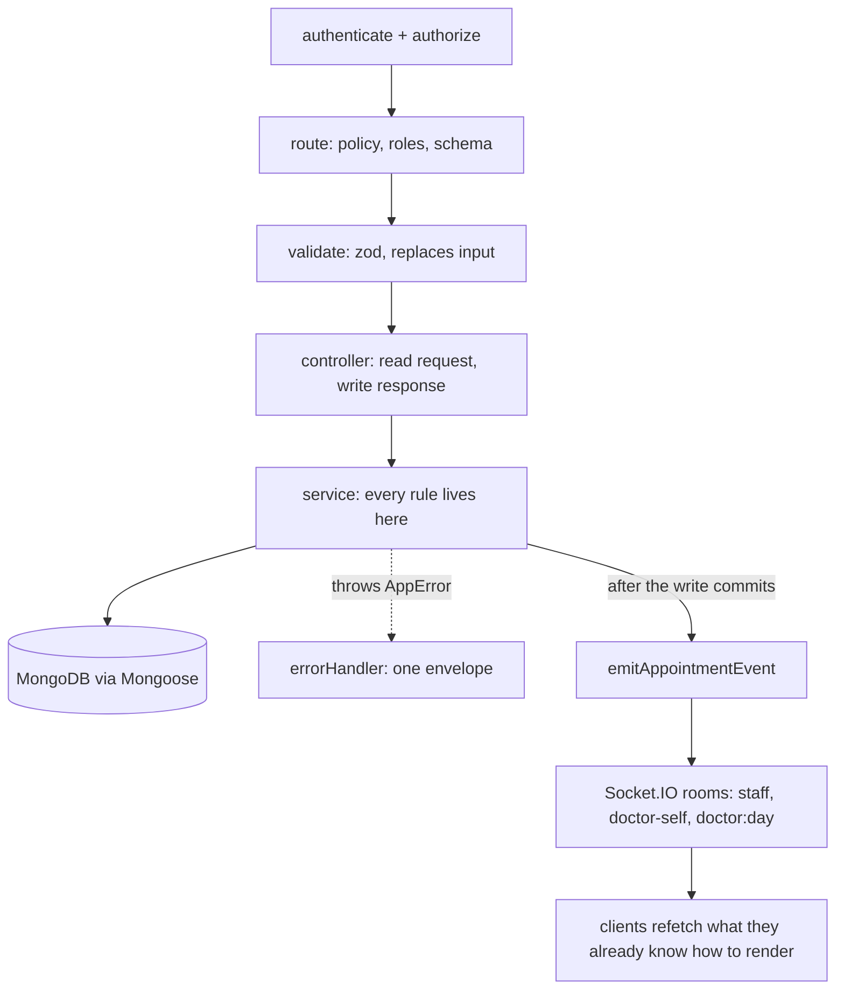
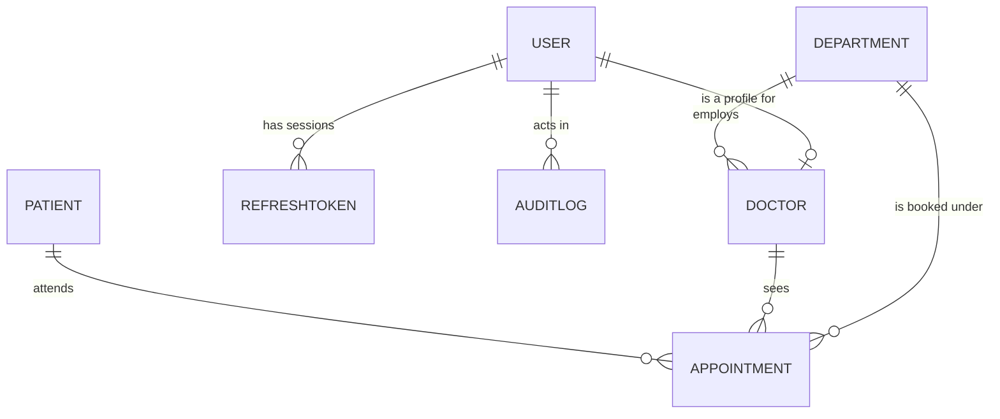

# EMR Appointment Management

Appointment module for a clinic: users and roles, doctor schedules, slot generation, booking with double booking protection, a status workflow, an audit trail, and a live board over sockets. Backend is Express and MongoDB, frontend is Vite and React.

## Project Overview

The system covers the working day of a small clinic from three points of view. A super admin manages the register (departments, doctors, receptionists) and each doctor's weekly schedule. A receptionist books, finds and moves visits along, and can register a new patient while doing so. A doctor opens their own board read only, sees only their own visits, and closes a visit once the patient has been seen.

What is implemented: authentication with rotating refresh tokens and role based access control, doctor schedules and slot generation, booking for a known or a brand new patient, a status workflow over one appointment row, an audited soft cancel, a filterable and sortable appointment list with server side paging, a dashboard with the clinic's own clock, and realtime updates over Socket.IO so a booking made at the front desk appears on the doctor's board without a refresh.

What is not implemented is listed honestly under Known Limitations.

## Stack

- Server: Node 20+, Express 5, MongoDB through Mongoose 9, CommonJS, zod for validation, Luxon for the clinic timezone, socket.io, Jest and supertest with mongodb-memory-server.
- Client: Vite, React 19, React Router 7, TanStack Query 5, Tailwind 3, axios, react-hook-form with zod, socket.io-client, lucide-react.

## Folder Structure

```
server/
  scripts/        seed.js, wipes and recreates the demo data
  src/
    config/       env.js (the only reader of process.env), db.js, constants.js
    controllers/  one thin function per route
    middlewares/  authenticate, authorize, validate, errorHandler, notFound, rateLimiters
    models/       User, RefreshToken, Department, Doctor, Patient, Appointment, AuditLog
    routes/       index.js plus one file per feature
    services/     all business logic, and the only place rules live
    sockets/      index.js (handshake, rooms, join/leave) and appointmentEvents.js (emits)
    utils/        AppError, response, asyncHandler, sequence, time
    validators/   zod schemas, one file per feature
  tests/          jest suites against an in-memory MongoDB
client/
  src/
    api/          one module per feature plus axiosClient, the only place a token is attached
    components/
      ui/         the design system: Button, Input, Select, Card, Badge, Modal, Pagination, Toast, ...
      layout/     AppLayout, Sidebar (the rail), TopBar (account menu and the phone drawer)
      dashboard/  TrendChart, DayList, UpcomingCard, DoctorsOnDuty
      scheduler/  SchedulerFilters, SlotGrid, SlotButton, BookingModal, PatientPicker, LiveIndicator
      appointments/ AppointmentRow, AppointmentCards, AppointmentsTable, AppointmentsFilters,
                    AppointmentDetailsModal, EditAppointmentModal, CancelAppointmentModal
      doctors/    AddDoctorModal, AddReceptionistModal, ScheduleEditorModal
    context/      AuthContext (the session), SocketContext (the one live connection), ToastContext
    hooks/        useDebounce, useDocumentTitle, useMediaQuery, useSocket
    pages/        Dashboard, Scheduler, Appointments, Doctors, Login, NotFound
    routes/       AppRoutes plus the ProtectedRoute guard
    utils/        constants, dateUtils, formatters, schedule, appointmentActions, formErrors
```

Two documents sit at the root: this file and [ENGINEERING_DECISIONS.md](ENGINEERING_DECISIONS.md), which answers why each non obvious choice was made. [api.http](api.http) is every endpoint as a runnable request.

## Architecture Overview

The request path is always the same five steps: a route states the policy (roles, validation, handler), the validator parses and replaces the input, the controller reads the request and calls one service function, the service holds every rule and throws `AppError` on a refusal, and the middleware chain turns that error into the same response envelope every other endpoint uses. Services never touch `res`, which is what lets the socket layer, the seed script and the tests call the same functions the HTTP routes call.



On the client, `api/` modules are the only place axios is touched, `context/` holds the session, the socket and the toasts, and pages compose components rather than fetching inside them. Every filter, sort and page lives in the query string, so a list screen has exactly one place to read its own configuration from and a link to a colleague lands on the same view.

## Database Design

Collections: `users`, `refreshtokens`, `departments`, `doctors`, `patients`, `appointments`, `auditlogs`, plus `counters` (one document per sequence, used only for patient codes).



Relationships are references for identity (`patientId`, `doctorId`, `departmentId`, `userId`) and denormalised snapshots for display: an appointment also carries `patientSnapshot` and `doctorSnapshot`, which is what the list page searches and renders without a join. Slots are not a collection. The grid is generated on read from the doctor's weekly schedule and then marked booked by the day's active appointments.

One sample document per main collection, with the fields that matter:

```js
// users
{ _id, name: "Dr. Ifeanyi Okafor", email: "dr.okafor@emr.test",
  passwordHash: "<bcrypt, select false, never serialised>", role: "doctor", isActive: true }

// departments
{ _id, name: "General Medicine", code: "GEN" }

// doctors (userId and the schedule are the two things an appointment cannot be booked without)
{ _id, userId, departmentId, name: "Dr. Ifeanyi Okafor", nameLower: "dr. ifeanyi okafor",
  specialization: "Consultant Physician", slotDurationMinutes: 15,
  schedule: [ { dayOfWeek: 1,
    sessions: [ { name: "Morning", start: "09:00", end: "12:00" },
                { name: "Evening", start: "13:00", end: "17:00" } ],
    breaks:   [ { name: "Lunch", start: "12:00", end: "13:00" } ] } ] }

// patients (patientCode comes from the counters collection, mobile is unique)
{ _id, patientCode: "PT-000001", name: "Chiamaka Nwosu", nameLower: "chiamaka nwosu",
  mobile: "08031234567", gender: "female", dateOfBirth: "1991-04-18", createdBy }

// appointments (date and times are strings, never Dates)
{ _id, patientId, doctorId, departmentId, date: "2026-10-16", startTime: "09:00", endTime: "09:15",
  status: "arrived", purpose: "Blood pressure review", notes: undefined,
  patientSnapshot: { name: "Chiamaka Nwosu", nameLower: "chiamaka nwosu",
                     mobile: "08031234567", patientCode: "PT-000001" },
  doctorSnapshot: { name: "Dr. Ifeanyi Okafor", nameLower: "dr. ifeanyi okafor" },
  createdBy, arrivedAt: ISODate, completedAt: undefined, cancelledAt: undefined, cancelReason: undefined }

// auditlogs
{ _id, userId, role: "receptionist", action: "APPOINTMENT_ARRIVED", entity: "Appointment",
  entityId, metadata: { from: "scheduled", to: "arrived" }, ip: "127.0.0.1" }
```

Indexes, and the reason for each, are tabulated in [ENGINEERING_DECISIONS.md](ENGINEERING_DECISIONS.md#indexes-and-why). The one that matters most is the partial unique index on `{ doctorId, date, startTime }` over the active statuses: it is the double booking guard.

## API Documentation

Base path `/api/v1`. Every response is `{ success, message, data, meta }`; errors set `success: false` and `data: null`, with `meta.code` for the client to branch on and `meta.details` for field level problems.

### Auth

| Method | Path | Roles | Description |
| --- | --- | --- | --- |
| GET | `/health` | public | liveness plus database state |
| POST | `/auth/login` | public | strict rate limiter, returns the access token and sets the refresh cookie |
| POST | `/auth/refresh` | refresh cookie | rotates the pair, the used token is deleted |
| POST | `/auth/logout` | refresh cookie | clears the cookie, always succeeds |
| GET | `/auth/me` | any signed in | the signed in user, safe fields only |

```http
POST /api/v1/auth/login
Content-Type: application/json

{ "email": "reception@emr.test", "password": "Password123!" }
```

```json
{
  "success": true,
  "message": "Signed in",
  "data": {
    "user": { "id": "...", "name": "Front Desk", "email": "reception@emr.test", "role": "receptionist" },
    "accessToken": "<jwt, 15m>"
  },
  "meta": {}
}
```

A wrong password, an unknown email and a deactivated account all answer with the same `401` and the same sentence, `Invalid email or password`.

### Departments and doctors

| Method | Path | Roles | Description |
| --- | --- | --- | --- |
| GET | `/departments` | any role | the department list, used as a filter |
| GET | `/doctors?departmentId=&q=` | any role | the doctor list; a doctor gets only their own record |
| GET | `/doctors/:id` | any role | one doctor; a doctor may only read their own id |
| POST | `/doctors` | super_admin | creates the login and the profile together |
| PUT | `/doctors/:id/schedule` | super_admin | replaces the slot duration and the weekly schedule |
| POST | `/users/receptionists` | super_admin | creates a receptionist login |

A rejected schedule comes back as a `400` with `meta.details` naming the exact path, for example `schedule.0.sessions.1.start`.

### Slots

| Method | Path | Roles | Description |
| --- | --- | --- | --- |
| GET | `/slots?doctorId=&date=` | any role | the generated grid; a doctor only for their own id |

Each slot is `available`, `booked` or `past`. Slots are never stored: the grid is built from that weekday's sessions, trimmed by breaks, then marked booked from the day's active appointments. A booked slot stays `booked` after its time passes, so the day view still shows the visit.

### Patients

| Method | Path | Roles | Description |
| --- | --- | --- | --- |
| GET | `/patients?q=` | receptionist, super_admin | one box for a code, a mobile number or a name |
| GET | `/patients/:id` | receptionist, super_admin, doctor | a doctor only for a patient they have seen |

A new patient whose mobile already exists is a `409` carrying the existing patient under `meta.details[0].existingPatient`, so the desk can offer "use this patient" instead of merging two people.

### Appointments

| Method | Path | Roles | Description |
| --- | --- | --- | --- |
| POST | `/appointments` | receptionist, super_admin | books a slot, for a known or a brand new patient |
| GET | `/appointments` | any role | filters, sorting and paging; a doctor sees only their own |
| GET | `/appointments/:id` | any role | one appointment; a doctor only for their own |
| PUT | `/appointments/:id` | receptionist, super_admin | purpose and notes only |
| DELETE | `/appointments/:id` | receptionist, super_admin | soft cancel, takes an optional reason |
| POST | `/appointments/:id/arrive` | receptionist, super_admin | scheduled to arrived, on the day only |
| POST | `/appointments/:id/complete` | doctor, super_admin | arrived to completed |

```http
POST /api/v1/appointments
Authorization: Bearer <receptionist access token>
Content-Type: application/json

{
  "doctorId": "68f1c0a2e4b0d3a1c8f4a111",
  "date": "2026-10-19",
  "startTime": "10:00",
  "newPatient": { "name": "Uche Obi", "mobile": "08040001111", "gender": "male" },
  "purpose": "Fever"
}
```

```json
{
  "success": true,
  "message": "Appointment booked",
  "data": {
    "appointment": {
      "id": "68f1c0a2e4b0d3a1c8f4a222",
      "date": "2026-10-19",
      "startTime": "10:00",
      "endTime": "10:15",
      "status": "scheduled",
      "purpose": "Fever",
      "patient": { "id": "...", "name": "Uche Obi", "patientCode": "PT-000004", "mobile": "08040001111" },
      "doctor": { "id": "...", "name": "Dr. Ifeanyi Okafor" },
      "departmentId": "..."
    }
  },
  "meta": {}
}
```

```http
GET /api/v1/appointments?dateFrom=2026-10-19&dateTo=2026-10-19&status=scheduled&sortBy=startTime&sortOrder=asc&page=1&limit=10
Authorization: Bearer <token>
```

```json
{
  "success": true,
  "message": "Appointments fetched",
  "data": {
    "appointments": [
      {
        "id": "...",
        "date": "2026-10-19",
        "startTime": "10:00",
        "endTime": "10:15",
        "status": "scheduled",
        "purpose": "Fever",
        "patient": { "id": "...", "name": "Uche Obi", "patientCode": "PT-000004", "mobile": "08040001111" },
        "doctor": { "id": "...", "name": "Dr. Ifeanyi Okafor" },
        "departmentId": "..."
      }
    ]
  },
  "meta": { "page": 1, "limit": 10, "total": 1, "totalPages": 1 }
}
```

Booking a slot someone already holds is a `409`, a time the grid does not offer is a `400` naming `startTime`, and an illegal status move is a `409` that names both ends, for example "Cannot move an appointment from completed to cancelled".

### Dashboard

| Method | Path | Roles | Description |
| --- | --- | --- | --- |
| GET | `/dashboard` | any role | the clinic's `today` plus counts; a doctor gets their own |
| GET | `/dashboard/trend?days=7` | any role | one zero filled entry per day ending today |

`today` is the clinic's calendar date in `CLINIC_TIMEZONE` and the only clock the client trusts, so a browser in another timezone cannot disagree with the server about what is past.

## Environment Variables

### server/.env

| Variable | Required | Default | Notes |
| --- | --- | --- | --- |
| `NODE_ENV` | no | `development` | `development`, `test` or `production` |
| `PORT` | no | `5000` | the API and the socket.io server share it |
| `MONGO_URI` | yes | none | `mongodb://127.0.0.1:27017/emr` locally, `mongodb://mongo:27017/emr` under compose |
| `JWT_ACCESS_SECRET` | yes | none | at least 32 characters, the server refuses to start without it |
| `ACCESS_TOKEN_TTL` | no | `15m` | any value `jsonwebtoken` accepts |
| `REFRESH_TOKEN_TTL_DAYS` | no | `7` | the cookie and the stored row use the same value |
| `CLIENT_ORIGIN` | no | `http://localhost:5173` | the one origin CORS allows, because cookies are sent |
| `CLINIC_TIMEZONE` | no | `Africa/Lagos` | any IANA zone; all "today" checks run against it |

### client/.env

| Variable | Required | Default | Notes |
| --- | --- | --- | --- |
| `VITE_API_TARGET` | no | `http://localhost:5000` | the dev proxy target; see [client/.env.example](client/.env.example) |

## Installation Instructions

Prerequisites: Node 20 or newer, and MongoDB reachable at `MONGO_URI` (a local `mongod`, MongoDB Atlas, or the compose file below).

```
git clone <repository-url>
cd <repository>

# server
cd server
cp .env.example .env      # then set JWT_ACCESS_SECRET to a long random string
npm install

# client (a second terminal)
cd ../client
cp .env.example .env      # optional, the defaults work
npm install
```

There are no other steps. The client needs no build step to run in development and the server creates its own indexes on boot.

## Running the Project

Two terminals, from the repository root:

```
npm run dev:server     # http://localhost:5000, health check at /api/v1/health
npm run dev:client     # http://localhost:5173, proxies /api and /socket.io to the server
```

The helper scripts in the root `package.json` are thin wrappers (`npm --prefix`), so `cd server && npm run dev` is exactly equivalent. There is also `npm run install:all`, `npm run seed` and `npm test` at the root.

A missing or malformed variable, for example a short `JWT_ACCESS_SECRET`, makes the server exit immediately with the exact problem printed. If your shell already exports `PORT` (some tooling sets it to `0`), that value wins over `server/.env` and the two would disagree: run it with `PORT=5000 npm run dev` in that case.

### Seed the demo data

```
npm run seed
```

This wipes the collections it owns, so never point it at real data. It creates three departments, three doctors, five patient records and the appointments described below.

| Role | Email | Password |
| --- | --- | --- |
| super_admin | admin@emr.test | Password123! |
| receptionist | reception@emr.test | Password123! |
| doctor | dr.okafor@emr.test | Password123! |
| doctor | dr.bello@emr.test | Password123! |
| doctor | dr.adeyemi@emr.test | Password123! |

The three doctors are General Medicine with 15 minute slots, Pediatrics with 20 and Cardiology with 30, all on a Monday to Friday 09:00 to 12:00 and 13:00 to 17:00 schedule with a lunch break, so the slot logic has an even grid, an uneven one and a coarse one to work with. Seven appointments are placed on the next working day in every status, the days behind today are filled with completed visits (one cancelled) so the dashboard trend is a line rather than a flat zero, and today carries one visit in each of the three live states, which is what the board reads.

### Docker

The compose stack is three services: `mongo`, the API built from [server/Dockerfile](server/Dockerfile), and nginx serving the built client from [client/Dockerfile](client/Dockerfile) with `/api` and `/socket.io` proxied to the API, so the refresh cookie stays first party on one origin.

Compose refuses to start without a signing secret. Write one into a root `.env` file first:

```
echo "JWT_ACCESS_SECRET=$(openssl rand -hex 32)" > .env
```

```
docker compose up --build
```

The API is on http://localhost:5000 (its health check is what the API and client containers wait for) and the UI on http://localhost:8080. Seed the demo data once the stack is up:

```
docker compose exec server npm run seed
```

Docker is not required for anything else. The compose file was written and its YAML was parsed, but it was not executed on the machine this was built on, which had no Docker installed; the two `npm run dev` terminals above are the path that was actually run and verified.

## Testing

```
npm test              # from the root, or `cd server && npm test`
```

Jest runs against an in-memory MongoDB, so no local database is needed and no real data is touched. The first run downloads the mongod binary once (a few minutes); later runs start in about two seconds.

Current result:

```
Test Suites: 8 passed, 8 total
Tests:       53 passed, 53 total
```

The suites are `utils`, `health`, `errorHandler`, `models` (indexes and constraints), `slotGenerator` (pure functions, no fixtures), `concurrency`, `dashboard` and `realtime`.

`tests/concurrency.test.js` is the one to read first. It fires twenty parallel bookings at one slot and asserts exactly one `201`, exactly nineteen `409`s and nothing else, then re-reads the database: one active appointment, one row, and only the two patients that survived the nineteen failed bookings. A second test cancels the winner and proves the slot reopens, which only works because the partial index excludes cancelled rows. It calls `Appointment.init()` before the burst, because on a fresh database the index may not exist yet and the test would otherwise pass for the wrong reason.

`tests/realtime.test.js` starts a real HTTP server with socket.io attached and drives it with socket.io-client: it checks the handshake against a missing, a malformed and an expired token, joins a room, books through the API and waits for the event to arrive, and checks that a doctor cannot join another doctor's board.

## Real-time Updates

The socket.io server rides on the same HTTP server and port as the API, and a connection is opened with the same access token: `io(url, { auth: { token } })`. A missing, malformed or expired token is refused with a `connect_error`, and the account behind it is re-read from the database, so a deactivated account loses its live board at the same moment it loses its requests.

Rooms are `doctor:{doctorId}:{date}` for one doctor's day, `doctor-self:{doctorId}` for everything a doctor owns, and `staff` for the desk. A receptionist or super admin is in `staff` from the moment they connect and a doctor is in their own `doctor-self` room, so both list screens are live without asking for anything. A scheduler screen narrows to one day with `scheduler:join { doctorId, date }` and drops it again with `scheduler:leave`; both acknowledge with `{ ok }`, and a doctor asking for another doctor's board is refused.

| Event | Payload | When |
| --- | --- | --- |
| `appointment:created` | `{ id, doctorId, date, startTime, status }` | a slot was booked |
| `appointment:updated` | same | purpose or notes changed, a visit arrived or was completed |
| `appointment:cancelled` | same | a visit was cancelled |

The payload deliberately carries nothing but those five fields. The client refetches the row it already knows how to read, so no patient data travels over a second channel with its own authorization rules, and a thin payload cannot disagree with what `GET /appointments/:id` returns. Emitting is best effort: it runs after the write has committed and a socket failure is logged rather than failing the API request that caused it.

## Assumptions Made

- Only the stated phases were provided, so anything not specified was resolved the simplest way and recorded here.
- One unique mobile number per patient. A second registration with the same number is a `409` that offers the existing record, rather than a merge.
- The clinic's timezone is a single zone (`CLINIC_TIMEZONE`, `Africa/Lagos` by default). There is no per doctor or per department timezone.
- Appointment dates and times are clinic wall clock strings. They are not instants, and nothing converts them.
- A cancelled slot is immediately bookable again. The cancelled row stays as the record.
- Receptionists cannot complete an appointment; only the doctor on the visit (or a super admin) can.
- Arriving is only allowed on the day of the appointment, never before.
- A doctor may open a patient only if they have at least one appointment with them.
- Search is a prefix match, so a bare surname does not find a titled name. This is a deliberate trade for index usage.
- API port 5000 and client port 5173 are the defaults, both configurable.
- The audit trail records who did what; it is not exposed as an endpoint, because no screen in the brief reads it.
- The sign in page carries a button per demo role that fills the form with a seeded account. That password is written in the client source on purpose, and both the button and the constant go with the seed data if this is ever pointed at real patients.

## Known Limitations

- No consultation notes, prescriptions, billing or patient documents. The brief stops at the appointment lifecycle.
- No password reset, no self registration and no email. Accounts are created by a super admin and passwords are issued by hand.
- No refresh token reuse detection: rotation narrows the window, but a detected replay does not revoke the user's other sessions.
- Audit writes are fire and forget and are not surfaced anywhere in the UI.
- The doctor register is not paginated. A clinic with hundreds of doctors would need the same treatment the appointment list already has.
- The appointments list uses `skip`/`limit` paging, which degrades on very deep pages. The fix is described in [ENGINEERING_DECISIONS.md](ENGINEERING_DECISIONS.md#scaling-to-millions-of-appointments).
- Slots are generated per request and are not cached.
- No TypeScript, so the API contract is enforced at runtime by zod rather than at compile time.
- The socket layer is single process. A second API instance needs the Redis adapter before emits reach sockets connected to it.
- There is no end to end browser test suite; the client was verified by hand against the running app, and the server has the Jest suites described above.

## Future Improvements

- Keyset (cursor) pagination for the appointment list, and a Redis cache for slot reads invalidated by the existing socket events.
- Refresh token reuse detection, with revocation of every session for that user when a rotated token is presented twice.
- Per doctor working exceptions: holidays, one-off closures and half days, layered over the weekly schedule.
- A waiting list for a fully booked doctor and a "next available" button that jumps the scheduler to the first free slot.
- SMS or email reminders before a visit, which is where a service like a transactional email provider would slot in.
- Printable and exportable day sheets for the front desk, and a CSV export of the filtered list.
- Follow-up appointments booked straight from a completed visit.
- Moving the audit trail to a queue and adding a read only audit screen for the operator.
- Moving the API behind a shared rate limiter at the gateway and issuing refresh tokens per device, so one device can be signed out on its own.

## License

Not licensed for redistribution. Built as a technical exercise.
