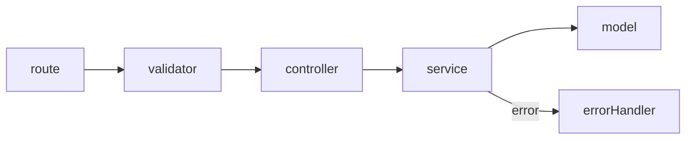
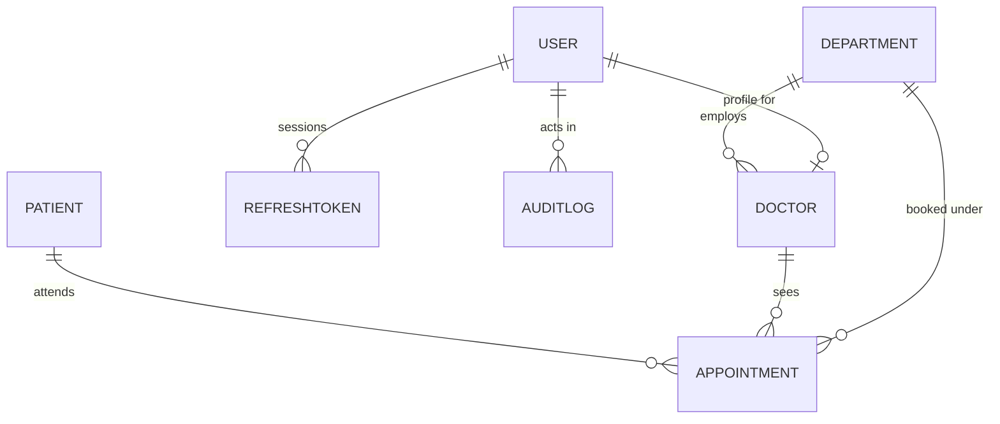

# PulseDesk

## Project Overview

PulseDesk is an appointment system for a small clinic. It covers a working day from three points of view, and each role sees a different part of it. A super admin adds departments, doctors and receptionists, and decides each doctor's weekly hours. A receptionist books visits, finds patients, and moves a visit from scheduled to arrived. A doctor opens their own board, sees only their own appointments, and completes a visit once the patient has been seen.

The server is Express and MongoDB. The website is Vite and React, and it talks to the api over http and Socket.IO.

## Folder Structure

```
server/
  scripts/        seed.js builds the demo clinic, seedData.js holds the made up records
  src/config/     env.js reads process.env, db.js connects, constants.js holds roles and statuses
  src/controllers/  one thin function per route
  src/middlewares/  authenticate, authorize, validate, rate limiters, errorHandler, notFound
  src/models/     User, RefreshToken, Department, Doctor, Patient, Appointment, AuditLog
  src/routes/     index.js plus one file per resource
  src/services/   every rule lives here
  src/sockets/    the socket server and the emit helpers
  src/utils/      AppError, response, asyncHandler, time, regex, sequence
  src/validators/ zod schemas, one file per resource
  tests/          jest suites against a temporary database
client/
  src/api/        one module per resource, plus the axios client
  src/components/  ui (buttons, inputs, cards), layout (rail, top bar), dashboard, scheduler,
                  appointments, doctors
  src/context/    the session, the socket, the toasts
  src/hooks/      document title, media query, minute tick, debounce
  src/pages/      Dashboard, Scheduler, Appointments, Doctors, Login, NotFound
  src/routes/     the router and the sign in guard
  src/utils/      constants, dates, formatters, schedule helpers
```

The rules live in `server/src/services`, and the client only calls the api from `client/src/api`.

## Architecture Overview

A request passes through the same five parts. The route states which roles may call it and which schema checks the input. The validator parses the body and the parsed result replaces what the client sent. The controller reads the request and sends the response. The service holds the rules and throws an `AppError` when it refuses. The model owns the data. Errors from any of these land in one middleware, so every failure answers with the same shape.

Socket.IO runs on the same http server and the same port as the api, and a client connects with the access token it already holds. Services do not touch `res`, so the socket layer, the seed script and the tests all call the same functions the routes call.



On the client, the api modules own every http call, the context files hold the session and the socket, and pages put components together. Every filter, sort and page lives in the query string, so a link to a colleague lands on the same list.

## Database Design

There are seven collections, plus a counters collection that only hands out patient codes.

| Collection | What it holds |
| --- | --- |
| users | the login accounts: name, email, hashed password, role, active flag |
| refreshtokens | one row per live session, stored as a hash of the token |
| departments | a name and a code, both unique |
| doctors | the profile behind a doctor account: department, specialisation, slot length, weekly schedule |
| patients | the register: sequential code, name, unique mobile, optional gender and birth date |
| appointments | one row per visit: doctor, patient, date, times, status, snapshots, timestamps |
| auditlogs | who did what, with a small metadata object and the ip address |



An appointment keeps ids for the patient, doctor and department, and it also keeps small copies of both names so the list page can render and search without a join. Dates and times are plain strings, never `Date` objects, because a stored instant would move a booking a day when the timezone changes.

A sample appointment document:

```js
{
  _id: ObjectId("68f1c0a2e4b0d3a1c8f4a222"),
  patientId: ObjectId("68f1c0a2e4b0d3a1c8f4a111"),
  doctorId: ObjectId("68f1c0a2e4b0d3a1c8f4a333"),
  departmentId: ObjectId("68f1c0a2e4b0d3a1c8f4a444"),
  date: "2026-10-19",
  startTime: "10:00",
  endTime: "10:15",
  status: "arrived",
  purpose: "Fever",
  notes: "Two days of fever, no rash",
  patientSnapshot: {
    name: "Uche Obi",
    nameLower: "uche obi",
    mobile: "08040001111",
    patientCode: "PT-000004"
  },
  doctorSnapshot: { name: "Dr. Ifeanyi Okafor", nameLower: "dr. ifeanyi okafor" },
  createdBy: ObjectId("68f1c0a2e4b0d3a1c8f4a555"),
  arrivedAt: ISODate("2026-10-19T09:58:00Z"),
  completedAt: null,
  cancelledAt: null,
  cancelReason: null,
  createdAt: ISODate("2026-10-15T11:02:00Z")
}
```

Indexes, and what each one is for:

| Index | Reason |
| --- | --- |
| appointments `{ doctorId, date, startTime }`, unique, partial on active statuses | stops a second booking in the same slot |
| appointments `{ doctorId, date, status }` | the doctor's day view |
| appointments `{ departmentId, date }` | one department's day |
| appointments `{ date, startTime }` | the default list order |
| appointments `{ patientSnapshot.mobile }` | mobile search in the filters |
| appointments `{ patientSnapshot.nameLower }` | patient name search in the filters |
| patients `{ nameLower }` | the name search box |
| doctors `{ departmentId }`, `{ nameLower }` | the doctor list and its search |
| refreshtokens `{ tokenHash }` unique, `{ userId }` | refresh rotation, and signing a user out everywhere |
| refreshtokens `{ expiresAt }` with a TTL | expired sessions delete themselves |
| auditlogs `{ createdAt }`, `{ entity, entityId }` | reading the trail |

The unique index on appointments only covers rows in an active status, so a cancelled visit leaves the index and its slot becomes free again. Two receptionists pressing book at the same moment means two inserts, and the database lets exactly one through. The loser gets error 11000, which the service turns into a 409.

## API Documentation

The base path is `/api/v1`. Every answer uses this shape, and errors set `success` to false with `data` set to null:

```json
{ "success": true, "message": "Signed in", "data": {}, "meta": {} }
```

Auth:

| Method | Path | Who | What it does |
| --- | --- | --- | --- |
| GET | `/health` | anyone | returns the status and the uptime |
| POST | `/auth/login` | anyone | exchanges an email and password for an access token, rate limited to 10 tries per 15 minutes |
| POST | `/auth/refresh` | the refresh cookie | rotates the pair and issues a new access token |
| POST | `/auth/logout` | the refresh cookie | clears the cookie and deletes the session row |
| GET | `/auth/me` | anyone signed in | returns the signed in user |

Departments, doctors and staff:

| Method | Path | Who | What it does |
| --- | --- | --- | --- |
| GET | `/departments` | any signed in account | the department list |
| GET | `/doctors?departmentId=&q=` | any signed in account | the doctor list, a doctor only gets their own record |
| GET | `/doctors/:id` | any signed in account | one doctor, a doctor only for their own id |
| POST | `/doctors` | super admin | creates the login and the profile |
| PUT | `/doctors/:id/schedule` | super admin | replaces the slot length and the weekly schedule |
| POST | `/users/receptionists` | super admin | creates a receptionist login |

Slots:

| Method | Path | Who | What it does |
| --- | --- | --- | --- |
| GET | `/slots?doctorId=&date=` | any signed in account | the generated grid for that doctor and date |

Patients:

| Method | Path | Who | What it does |
| --- | --- | --- | --- |
| GET | `/patients?q=` | receptionist, super admin | one search box for a code, a mobile or a name |
| GET | `/patients/:id` | receptionist, super admin, doctor | one patient, a doctor only if they have seen them |

Appointments:

| Method | Path | Who | What it does |
| --- | --- | --- | --- |
| POST | `/appointments` | receptionist, super admin | books a slot for a known or a new patient |
| GET | `/appointments` | any signed in account | the filterable, sortable, paged list |
| GET | `/appointments/:id` | any signed in account | one appointment, a doctor only for their own |
| PUT | `/appointments/:id` | receptionist, super admin | changes the purpose and the notes |
| DELETE | `/appointments/:id` | receptionist, super admin | cancels, with an optional reason |
| POST | `/appointments/:id/arrive` | receptionist, super admin | scheduled becomes arrived, on the day only |
| POST | `/appointments/:id/complete` | doctor, super admin | arrived becomes completed |

Dashboard:

| Method | Path | Who | What it does |
| --- | --- | --- | --- |
| GET | `/dashboard` | any signed in account | today's counts, and for a doctor the next patient |
| GET | `/dashboard/trend?days=7` | any signed in account | one zero filled entry per day, ending today |
| GET | `/dashboard/calendar?month=2026-10` | any signed in account | one count per day of that month |

Example, signing in:

```http
POST /api/v1/auth/login
Content-Type: application/json

{ "email": "reception@emr.test", "password": "Password123!" }
```

```json
{
  "success": true,
  "message": "Signed in",
  "data": {
    "accessToken": "<jwt, 15 minutes>",
    "user": { "id": "68f1c0a2e4b0d3a1c8f4a555", "name": "Blessing Udoh", "email": "reception@emr.test", "role": "receptionist" }
  },
  "meta": {}
}
```

The refresh token is set as an httpOnly cookie on the same call. A wrong email, a wrong password and a deactivated account all answer with 401 and the sentence `Invalid email or password`.

Example, booking a visit:

```http
POST /api/v1/appointments
Authorization: Bearer <receptionist access token>
Content-Type: application/json

{
  "doctorId": "68f1c0a2e4b0d3a1c8f4a333",
  "date": "2026-10-19",
  "startTime": "10:00",
  "newPatient": { "name": "Uche Obi", "mobile": "08040001111", "gender": "male" },
  "purpose": "Fever"
}
```

```json
{
  "success": true,
  "message": "Appointment booked",
  "data": {
    "appointment": {
      "id": "68f1c0a2e4b0d3a1c8f4a222",
      "date": "2026-10-19",
      "startTime": "10:00",
      "endTime": "10:15",
      "status": "scheduled",
      "purpose": "Fever",
      "notes": null,
      "departmentId": "68f1c0a2e4b0d3a1c8f4a444",
      "doctor": { "id": "68f1c0a2e4b0d3a1c8f4a333", "name": "Dr. Ifeanyi Okafor" },
      "patient": { "id": "68f1c0a2e4b0d3a1c8f4a111", "name": "Uche Obi", "patientCode": "PT-000004", "mobile": "08040001111" }
    }
  },
  "meta": {}
}
```

That call answers with 201. Booking a slot someone already holds is a 409. A time the grid does not offer is a 400 naming `startTime`, and moving a visit along a path the workflow does not allow is a 409 that names both ends.

## Environment Variables

`server/.env`

| Name | Required | Example | Note |
| --- | --- | --- | --- |
| `MONGO_URI` | yes | `mongodb://127.0.0.1:27017/emr` | the database address |
| `JWT_ACCESS_SECRET` | yes | a 32 character random string | the server refuses to start without one of 32 characters or more |
| `NODE_ENV` | no | `development` | one of development, test or production |
| `PORT` | no | `5000` | the api and Socket.IO share it |
| `ACCESS_TOKEN_TTL` | no | `15m` | anything jsonwebtoken accepts |
| `REFRESH_TOKEN_TTL_DAYS` | no | `7` | the cookie and the stored row use the same value |
| `CLIENT_ORIGIN` | no | `http://localhost:5173` | the one origin CORS allows |
| `CLINIC_TIMEZONE` | no | `Africa/Lagos` | any valid IANA zone, and the clock every today check uses |

`client/.env`

| Name | Required | Example | Note |
| --- | --- | --- | --- |
| `VITE_API_TARGET` | no | `http://localhost:5000` | where the dev proxy sends api calls |
| `VITE_API_URL` | no | `https://pulsedesk-api.kamy.name.ng` | the api origin, unset in development so calls stay relative, read by the production build |

## Installation Instructions

1. Install Node 20 or newer and have MongoDB running, either a local `mongod` or a cluster you can reach.
2. Clone the repository and enter it: `git clone <repository-url> && cd <repository>`.
3. Set up the server: `cd server`, copy `.env.example` to `.env`, then set `JWT_ACCESS_SECRET` to a long random string. Run `npm install`.
4. Set up the client in a second terminal: `cd client`, copy `.env.example` to `.env` if the api is not on the default port, then run `npm install`.

From the root, `npm run install:all` installs both sides in one go. The server creates its own indexes when it boots, so there is no migration step.

## Running the Project

Two terminals, both from the repository root:

```
npm run dev:server     http://localhost:5000, health check at /api/v1/health
npm run dev:client     http://localhost:5173, proxies /api and /socket.io to the server
```

`cd server && npm run dev` is the same thing, because the root scripts only wrap `npm --prefix`.

A bad environment stops the server at boot with the exact problem printed, for example `JWT_ACCESS_SECRET: JWT_ACCESS_SECRET must be at least 32 characters`. One thing to watch: the shell wins over `.env`, so a `PORT` already exported by some other tool overrides yours. Run `env -u PORT npm run dev` if that happens.

Seed the demo clinic with `npm run seed`. It empties the collections it owns, so never point it at real data, and it refuses to run under `NODE_ENV=production` unless you pass `--force`. The demo dates are built from the clinic's today, so the visits are always around now.

| Role | Email | Password |
| --- | --- | --- |
| super admin | admin@emr.test | Password123! |
| receptionist | reception@emr.test | Password123! |
| receptionist | reception2@emr.test | Password123! |
| doctor | dr.okafor@emr.test | Password123! |
| doctor | dr.ibrahim@emr.test | Password123! |
| doctor | dr.bello@emr.test | Password123! |
| doctor | dr.adeyemi@emr.test | Password123! |
| doctor | dr.sani@emr.test | Password123! |
| doctor | dr.etim@emr.test | Password123! |
| doctor | dr.williams@emr.test | Password123! |

The sign in page has a button per role that fills the form, so you can try each one without typing.

Run the tests with `npm test`. They use a temporary database, so nothing of yours is touched. The first run downloads that binary once and takes a few minutes, later runs take about a minute.

The eight suites are utils, health, errorHandler, models, slotGenerator, concurrency, dashboard and realtime, and a green run prints `Test Suites: 8 passed, 8 total` and `Tests: 57 passed, 57 total`.

Real-time updates use rooms. A receptionist or super admin joins the `staff` room on connect, a doctor joins their own `doctor-self` room, and a scheduler screen also joins `doctor:{doctorId}:{date}` for the day it is showing. The server sends `appointment:created`, `appointment:updated` and `appointment:cancelled` after the write has committed, each carrying only the id, doctor, date, start time and status. The client then refetches the rows it already knows how to render, so no patient data travels over the socket.

The Docker files, `docker-compose.yml`, `server/Dockerfile` and `client/Dockerfile`, are written but have never been run on a machine with Docker.

## Deploying

The demo runs as three pieces: MongoDB Atlas for the database, a Render web service for the api, and
Vercel for the built client. The client is served from `https://pulsedesk.kamy.name.ng` and the api
from `https://pulsedesk-api.kamy.name.ng`.

### Database: MongoDB Atlas

1. Create a free cluster, then a database user for the app.
2. Under Network Access, allow `0.0.0.0/0`. Render's instances do not have a fixed outbound address, so
   there is no smaller list that always works.
3. From Connect, Drivers, copy the connection string and put it in `MONGO_URI` with the database name
   added, for example `mongodb+srv://<user>:<password>@<cluster>.mongodb.net/pulsedesk?retryWrites=true&w=majority`.

### API: Render

Create a Web Service from this repository with:

| Setting | Value |
| --- | --- |
| Root directory | `server` |
| Build command | `npm install` |
| Start command | `npm start` |

Environment (the names and production values are also in `server/.env.example`):

| Name | Value |
| --- | --- |
| `NODE_ENV` | `production` |
| `MONGO_URI` | the Atlas connection string |
| `JWT_ACCESS_SECRET` | a fresh random string of 32 characters or more |
| `CLIENT_ORIGIN` | `https://pulsedesk.kamy.name.ng` |
| `CLINIC_TIMEZONE` | `Africa/Lagos` |

`PORT` is left alone: Render provides it and the server reads it. In production the refresh cookie is
`Secure` and `SameSite=Lax`, `CLIENT_ORIGIN` is the one origin CORS and the socket allow, and the app
trusts the single proxy in front of it so the rate limiter sees the real client ip.

Add the custom domain `pulsedesk-api.kamy.name.ng` to the service and point its CNAME at the hostname
Render shows, which looks like `pulsedesk-api.onrender.com`.

### Client: Vercel

1. In Vercel, add a new project and import this repository.
2. Set the Root Directory to `client`. Vercel then detects Vite, so the build command stays `npm run build`
   and the output directory stays `dist`.
3. Add the environment variable `VITE_API_URL` with the value `https://pulsedesk-api.kamy.name.ng`, for
   both Production and Preview. It is read at build time, so changing it needs a redeploy.
4. Deploy, then add the custom domain `pulsedesk.kamy.name.ng` under Settings, Domains.

`client/vercel.json` rewrites every path to `/index.html`, so a deep link such as `/scheduler` survives a
refresh while the real files under `/assets` are still served. Every push to `main` deploys; only the
client is built there, and the api and its secrets stay on Render.

### DNS

Two CNAME records, both at whoever answers for `kamy.name.ng`, and the old `pulsedesk` record that
pointed at `kams983.github.io` has to go:

| Type | Name | Value | For |
| --- | --- | --- | --- |
| CNAME | `pulsedesk` | the per-project hostname Vercel shows, such as `d1d4fc829fe7bc7c.vercel-dns-017.com` | the client on Vercel |
| CNAME | `pulsedesk-api` | `pulsedesk-api.onrender.com` | the api on Render |

No A records are needed, because both names are subdomains. Each provider issues its certificate once the
record resolves, which can take a few minutes.

### Seeding Atlas once

The seed script fills the deployed database with the demo clinic and its logins. Point a local
`server/.env` at Atlas and run it once from the repository root with `npm run seed`. It empties the
collections it owns, so never point it at data you want to keep, and it refuses to run under
`NODE_ENV=production` unless it is given `--force`, which a local run does not need. The demo dates are
built from the clinic's today, so running it again later refreshes the "today" boards.

## Assumptions Made

- One mobile number per patient. Registering a number that already exists answers with 409 and offers the existing record instead of merging.
- The clinic has one timezone, `CLINIC_TIMEZONE`, and every check of what is today uses it.
- Cancelling frees the slot straight away. The cancelled row stays as the record.
- Only the doctor on the visit, or a super admin, can complete it. The desk marks people as arrived.
- A doctor only ever sees their own appointments, whatever the query string asks for.
- Arriving is allowed on the day of the visit, not before.
- Times are wall clock strings in the clinic's timezone. Nothing converts them.

## Known Limitations

- The Docker stack was never run, so it is written but unverified.
- There is no end to end browser test. The client was checked by hand, and the server has the jest suites.
- The list uses offset paging, which gets slow on very deep pages.
- Refresh tokens rotate, but a replayed token does not revoke the other sessions of that user.
- There is no password reset and no self sign up. A super admin creates every account.
- There are no consultation notes, prescriptions, billing or patient documents.
- The socket layer is a single process, so a second api instance needs the Redis adapter.

## Future Improvements

- Cursor paging for the appointment list, and a Redis cache for slot reads.
- Reuse detection for refresh tokens, signing out every session of that user.
- Working exceptions per doctor: holidays, half days and one off closures.
- A waiting list for a fully booked doctor, with a button that jumps to the first free slot.
- Reminders by email or SMS before a visit.
- A printable day sheet for the desk, and a CSV export of the filtered list.
